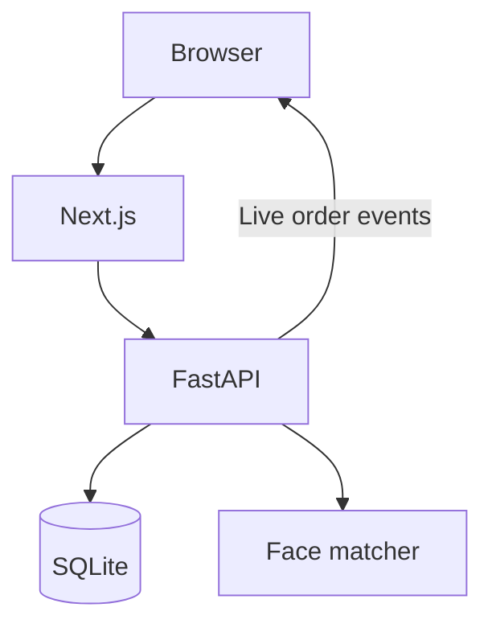

# Architecture and design decisions

CampusDine serves one canteen. The browser presents role-specific screens; FastAPI enforces permissions and owns all financial decisions. SQLite stores durable state. The Next.js server forwards `/api/...` to the backend so cookies remain on the website origin.

The WebSocket follows `/api/ws/orders` through the proxy to `/ws/orders`. Production Nginx forwards the upgrade and keeps the session cookie and Origin header. The API checks the session and role, then sends a consistent snapshot followed by committed updates.

## Authentication

Enrollment creates a pending student and a numerical face encoding. Admin approval is required for student login. Passwords are hashed with Argon2; session tokens are random and only their hashes are stored in the database. Browser cookies are HttpOnly and SameSite=Lax, with Secure enabled for HTTPS deployments. Writes require origin and CSRF checks after authentication. All HTTP API responses carry `Cache-Control: no-store`.

Each session belongs to one student, staff member or administrator. Signing into a different account in the same browser profile replaces the previous session. Use separate profiles for simultaneous role demonstrations.

Optional face login compares a captured encoding with active, approved enrollments. A unique match starts a student session. Multiple matches are rejected instead of choosing the nearest face. A face encoding is biometric data, not an anonymous identifier. This image matcher provides no liveness detection and is not sufficient evidence of production-grade biometric authentication.

## Checkout and accounting

Amounts are integer paisa. The frontend displays rupees, but the backend reads current prices, stock availability and account eligibility before charging. A checkout key is unique per student and is associated with a request fingerprint. Retrying the same request returns its original order; reusing the key with different content is rejected.

Order creation, daily token allocation, financial updates and ledger entries are committed in one transaction. SQLite write transactions use `BEGIN IMMEDIATE` where necessary to avoid stale read-to-write upgrades. Face encoding is performed before acquiring a write lock because image processing is comparatively expensive.

A wallet pays the whole order if sufficient. Otherwise the whole order uses credit if the remaining limit permits it. There is no split wallet/credit payment. Settlements reference the reviewed ledger entries and total, so orders created after review are not silently settled. Menu item names and prices are copied into order lines to preserve purchase history after menu edits.

## Live order state

Staff alone can advance Received → Preparing → Ready → Collected. Updates include the expected current state, preventing a stale screen from skipping stages. The server publishes after committing. Student connections receive only that student's orders; staff receive the canteen queue.

Snapshots carry a revision watermark. Clients retain per-order revisions and discard stale events. A collected order cannot reappear because an older event arrives late. Disconnects preserve the last visible state while disabling staff writes; reconnection replaces it with a fresh snapshot. Browser session storage retains uncertain request keys so retries do not create new charges or advance an extra stage.

The connection registry and attempt counters are in memory, so the deployment uses one API worker. Multiple workers would require shared event delivery and shared rate limiting.

## Background jobs

Email uses a database outbox with retry leases. SMTP calls run outside long database transactions. Delivery depends on external SMTP configuration; live order tracking works independently of email.

Recommendations prefer repeated purchases, then cached item co-occurrence, popular dishes and available menu items. The nightly job computes item similarity from purchase baskets while excluding the target student's own contributions. Stale caches fall back to current menu data. Scores are similarities, not calibrated probabilities.

## Scope and trade-offs

SQLite avoids a separate database service for the single-canteen scope. It permits concurrent readers but serializes writes; back up safely, keep write transactions short and measure contention before expanding the deployment.

Automated tests cover permissions, transactions, retries, reporting, queue events and browser interactions. Synthetic faces and mocked encoder results cannot establish real-camera accuracy. Real SMTP, TLS, proxy configuration, face matching and operational recovery must be checked on the target system.
